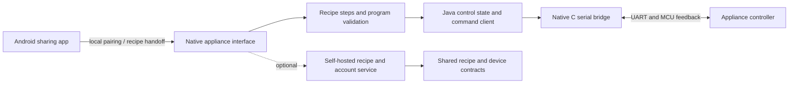

# KitchenOS

**An open software layer for the kitchen robot you already own.**

KitchenOS explores how a Xiaomi / Chunmi Cooking Robot can become an understandable,
extensible cooking appliance: a native interface on its built-in Android display,
recipes with explicit machine steps, and a controller whose commands and limits can
be inspected in source.

This is an **experimental developer source release**, focused on the
**CM0801K_EN / C3** reference device. It is not a replacement Android distribution,
a finished consumer firmware, or a universal installer. We are publishing the
implementation and the reasoning so others can study it and help improve it.

## Why we are building it

A connected kitchen appliance combines useful hardware with a software experience
that is often difficult to extend. We want cooking instructions, device state and
physical controls to fit together: see what the machine knows, understand what it
is about to do, and keep a deliberate start and a reachable stop.

The work grew alongside **Kalomatik**, our recipe and meal-planning project.
KitchenOS contains integration code for that ecosystem, but public source access
does not include a hosted backend, AI quota, user accounts or a recipe database.

## Our approach

1. **Understand the existing appliance.** Trace the Android application, serial
   protocol and observed device behavior before designing a replacement control
   path. Publish our own implementation; keep manufacturer applications and
   firmware out of the repository.
2. **Separate presentation from control.** Android owns the interaction and recipe
   flow. A small native process owns the MCU serial connection. Shared profiles
   describe allowed combinations of time, temperature, speed and direction.
3. **Treat a recipe as structured instructions.** Human preparation, weighing,
   resting and machine execution are different step types. Program validation
   checks ingredient accounting, revision identity and device capability. An AI
   suggestion is not permission to run a motor or heater.
4. **Make uncertainty visible.** Requested settings, received telemetry and a
   confirmed running program are distinct states. Missing or stale feedback must
   not be presented as a successful action.
5. **Build evidence in layers.** Unit tests establish software behavior; emulator
   tests establish Android behavior; supervised trials establish behavior on one
   physical appliance. Passing one layer does not replace the next.



## What is included

| Directory | Purpose |
| --- | --- |
| `machine/` | Native Android appliance UI, guided functions, state handling and C controller |
| `phone/` | Android share target and local setup / pairing flow |
| `phone-link/` | Reusable Android library for the phone setup flow |
| `common/` | Shared Android helpers, recipe validation and device profile |
| `backend/` | Recipe, account and AI service modules, authored recipe examples and offline tests |
| `docs/` | Architecture, build instructions, validation status and publication scope |
| `scripts/` | Offline publication and controller-integrity checks |

The source includes manual controls, weighing, recipe handoff, guided programs,
pantry / planning workflows and account / assistant integration. These areas have
different maturity levels. The snapshot contains development after the last
documented device installation; it is not an approved appliance release.

## Start without an appliance

The backend tests use test doubles and do not require a kitchen robot, cloud login
or a paid model call. Install **Node.js 22** and run:

```sh
git clone https://github.com/nited-ai/KitchenOS-OpenSource.git
cd KitchenOS-OpenSource/backend
npm ci
npm run build
npm test
```

To check the public snapshot and pinned controller artifacts, install Python 3:

```sh
cd ..
python scripts/check-publication.py
```

For Android, use **JDK 17**, **Android SDK 34**, **Build Tools 34.0.0**, and
**NDK 27.1.12297006**. The existing native standby build expects a **Windows**
NDK host. From a PowerShell prompt in the repository root:

```powershell
$env:ANDROID_HOME = 'C:/path/to/Android/Sdk'
./gradlew.bat :machine:testApplianceUnitTest :machine:assembleAppliance :phone:assembleDebug
```

Building does not install or run an APK on a device. The controller requires
privileged access on compatible appliance hardware; ordinary phones and emulators
do not provide its MCU. See [the build guide](docs/BUILDING.md) before attempting
hardware work.

## Current boundaries

- Physical development has used one reference appliance. Compatibility with other
  models, firmware revisions and untouched locked devices is unverified.
- The source contains experimental control profiles, including changes whose
  physical behavior is still pending validation. No prebuilt appliance installer,
  root package or firmware image is published here.
- Manufacturer artwork, provider logos, product photography and mixed-origin 3D
  assets are omitted. Existing fallback drawings remain; the public source
  edition does not reproduce every image from the private development build.
- The optional cloud API is disabled by default in the public Android build.
  Some user-initiated catalogue and image features still reference public
  Kalomatik URLs. They need network access, may change, and are not included
  services. See [configuration and network behavior](docs/BUILDING.md#network-and-cloud-configuration).
- This publication has no new physical-device validation. Test results and
  outstanding checks are recorded in [validation status](docs/STATUS.md).

## Help improve KitchenOS

Useful first contributions include making the native build portable, improving
offline development, replacing omitted artwork with original assets, reviewing
protocol handling, adding test coverage and documenting reproducible observations
on explicitly identified hardware.

Start with [CONTRIBUTING.md](CONTRIBUTING.md). For controller work, include the
device / firmware version, exact source revision, requested settings, observed
feedback and how the appliance returned to idle. Please do not publish account
tokens, raw backups, serial numbers or manufacturer binaries in issues.

## License and attribution

The project's original code is released under the [MIT License](LICENSE).
Included third-party icons and the Gradle wrapper retain their own licenses;
see [THIRD_PARTY_NOTICES.md](THIRD_PARTY_NOTICES.md). Project and manufacturer
names identify their respective projects and products; this code license does
not grant trademark rights. KitchenOS is an independent project and is not
affiliated with or endorsed by Xiaomi or Chunmi.
