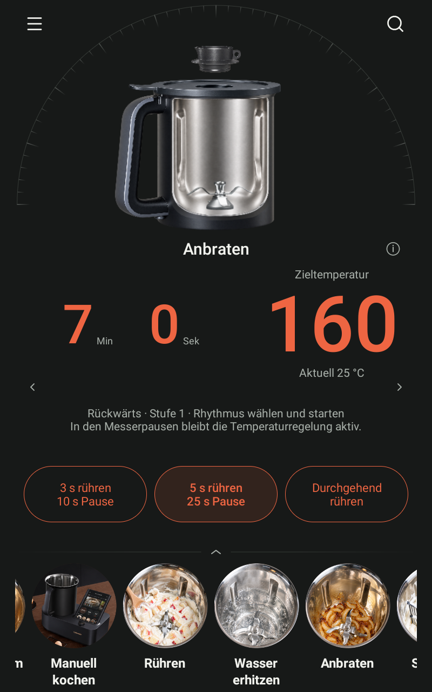
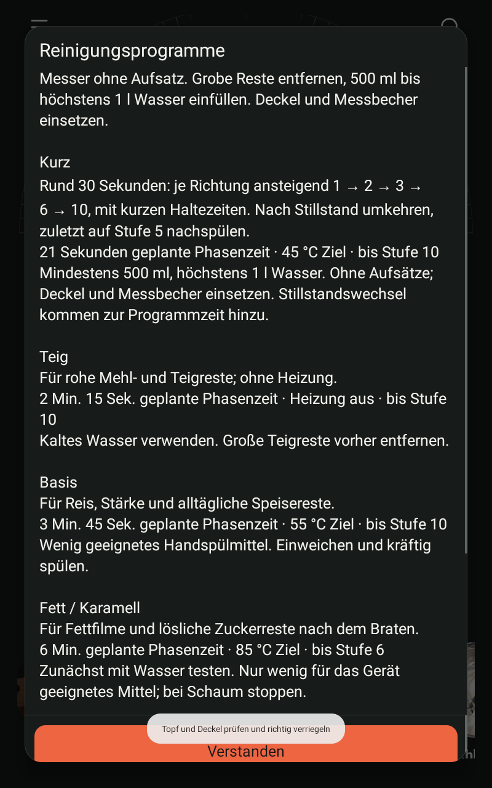

<div align="center">

# Xiaomi Smart Cooking Robot

### Your robot. Your recipes. Your rules.

**A new interface. A direct connection to the machine. A kitchen beyond the manufacturer's recipe catalogue.**

[](LICENSE)
[](https://github.com/nited-ai/Xiaomi-Smart-Cooking-Robot/actions/workflows/checks.yml)


[See the interface](#see-what-we-mean) · [Why we built it](#the-pot-belongs-on-screen) · [Bring your recipes](#the-web-is-bigger-than-one-recipe-catalogue) · [Build with us](#for-the-people-who-want-to-open-it-up)

**Set up your robot:** [Step-by-step guide (English)](docs/INSTALLATION.md) · [Schritt für Schritt (Deutsch)](docs/INSTALLATION.de.md)

</div>

You bought a powerful cooking robot. You should be able to decide how you use it.

We are opening up the software around the **Xiaomi / Chunmi Smart Cooking Robot
(CM0801K_EN / C3)**: a native Android interface, a local controller and a recipe
workflow that can grow beyond the recipes the appliance shipped with.

**The goal is simple: make the machine feel like yours.** Easier to understand
while you cook. Open to your recipes. Open to your ideas. Open for developers
who want to find out what this hardware can really do.

## The pot belongs on screen

You lift the lid. Take the bowl out. Put it back. Switch from one function to
another. In the middle of cooking, these are the moments that matter.

You should be able to glance at the screen and understand what the appliance
knows, without losing the controls you were using.

**That is why the vessel view has a permanent place at the top of our main
cooking interface.** The working area changes below it. The pot stays part of
the conversation: present or missing, lid open or closed, known or still being
checked. It is a view of device state, rather than a decorative picture of a
kitchen machine.

It is the immediate feedback we missed in the original experience, and the
starting point for the interface we wanted to cook with ourselves.

The measuring cup is different: its placement uses explicit user confirmation.
The app handles missing feedback separately; during some interruptions it keeps
the last confirmed vessel presentation. We want useful confidence at the counter,
grounded in what the machine has actually reported.

## See what we mean

<p align="center">
  <a href="docs/images/frying.png"></a>
  <a href="docs/images/cleaning.png"></a>
</p>

**Frying — the machine stays in view.** Fixed vessel area, clear time and
temperature, direct stirring choices and a function strip that keeps the next
action close.

**Cleaning — guidance where you need it.** Preparation and program explanations
inside the same interface, so you can understand a function before using it.
Select either screen to open the full-resolution image.

These are **unaltered captures from the latest available development UI,
Build 191, 26 October 2026**. They show the actual Android interface with
test/emulated device state. They are not photos of a validated cooking trial.
The minimal public source uses schematic fallbacks for omitted product imagery.
[Capture provenance](docs/images/README.md).

## The web is bigger than one recipe catalogue

A favourite recipe on a website. A family recipe in a message. Ingredients you
already have at home. That is where cooking starts for many of us.

**We want those recipes to have a way onto the robot, too.**

- **Share a recipe link from Android.** The importer reads supported public
  pages with structured `schema.org Recipe` data.
- **Bring the text instead.** Paste ingredients and instructions when a site
  cannot be imported directly.
- **Turn an idea into a cooking workflow.** The optional service can prepare
  structured instructions with ingredients, portions, human preparation and
  explicit machine steps. Its AI and account features need your own service
  configuration and provider access.
- **Keep the human in charge.** A recipe guide, a prepared machine program and
  an explicit start are separate things. The program must fit the device's
  supported combinations of time, temperature, speed and direction.

The ambition is broad: **your recipes, wherever you found them**. The current
importer has practical limits: not every site exposes readable recipe data,
some pages block access, and a recipe on the internet is not automatically a
validated motor-and-heater program. Text import is the fallback, not a promise
that every URL works.

## No Xiaomi cloud in the cooking-control loop

The core control path is local:

**Android interface → native serial bridge → appliance MCU → reported state.**

There is no Xiaomi-cloud request in that path. The controller communicates
directly with the appliance over UART; its implementation, command handling
and device profiles are available to inspect and change.

That distinction matters. Core appliance control should not need a round trip
through the manufacturer's servers. Online recipes still need internet access;
optional AI, account and catalogue services have their own dependencies. This
project makes those boundaries explicit and keeps the public cloud API disabled
by default. [Network and configuration details](docs/BUILDING.md#network-and-cloud-configuration).

## For owners who want more from their robot

This project is for the person who looks at that display and thinks:
**“There is so much more this machine could do.”**

We are working toward an appliance that explains its state, gives you direct
controls, accepts recipes from outside its original ecosystem and can keep
improving through an open community.

Today this is a **developer preview for compatible, prepared hardware**. The
reference setup uses privileged/root access. The repository contains the
application and controller source; it does not yet provide a universal one-click
root tool or consumer installer. If your first question is how to get access to
the hardware, start with the **[device-access and installation guide](docs/INSTALLATION.md)**
([Deutsch](docs/INSTALLATION.de.md)). It explains the factory Network ADB entry,
the separate Magisk requirement, how to build/install the app and what to check
before using the controls.

## For the people who want to open it up

An Android app is only the beginning. There is a real appliance behind it:
physical controls, a scale, a motor, a heater, a lid and a separate controller.
We want more people to be able to understand that system and build on it.

| Build on | What is here |
| --- | --- |
| **A native appliance interface** | Persistent vessel presentation, manual controls, weighing and guided functions in `machine/` |
| **A direct hardware path** | Project-owned C serial bridge, feedback handling and pinned controller artifacts |
| **Recipes beyond the vendor catalogue** | Android sharing/import in `phone/`, recipe and program contracts in `common/` |
| **An optional service you can configure** | Authentication, private drafts, recipe preparation, pantry and AI integrations in `backend/` |
| **A foundation to verify and extend** | Offline tests, source/profile integrity checks and CI |

The project grew under the internal name **KitchenOS** alongside **Kalomatik**.
Those names remain in package identifiers and parts of the code; this public
project is **Xiaomi Smart Cooking Robot**.

### Start without touching an appliance

With Node.js 22:

```sh
git clone https://github.com/nited-ai/Xiaomi-Smart-Cooking-Robot.git
cd Xiaomi-Smart-Cooking-Robot/backend
npm ci
npm run build
npm test
```

The included suite checks software behavior with test doubles and mocked
providers; no cooking robot, cloud account or paid model call is needed.

[Build the Android apps](docs/BUILDING.md) · [Understand the architecture](docs/ARCHITECTURE.md) · [Contribute](CONTRIBUTING.md) · [Read the validation status](docs/STATUS.md)

## Help write the next chapter

Bring your device observations. Improve the recipe importer. Make development
easier to reproduce. Review the protocol. Help turn a confusing appliance state
into something that makes sense at a glance.

**Star the project, open an issue, or send a focused pull request.** A useful
report says what you tried, what the screen showed and what the actual machine
did. That is how we turn promising experiments into something people can trust.

## Where we are today

The public source is an experimental development snapshot. Physical work has
used one reference appliance; compatibility with untouched locked devices and
other firmware versions remains open. Some newer control behavior is still
awaiting supervised physical validation. Firmware, manufacturer APKs, private
keys and personal backups are excluded. [Full status and boundaries](docs/STATUS.md).

## Open code, independent project

Original project code is available under the **[MIT License](LICENSE)**.
Third-party components retain their licenses; screenshots and depicted imagery
are explained in [the notices](THIRD_PARTY_NOTICES.md). The code license does not
grant rights to third-party content, firmware or trademarks.

This is an independent community project, not an official Xiaomi or Chunmi
release and not endorsed by either manufacturer.
